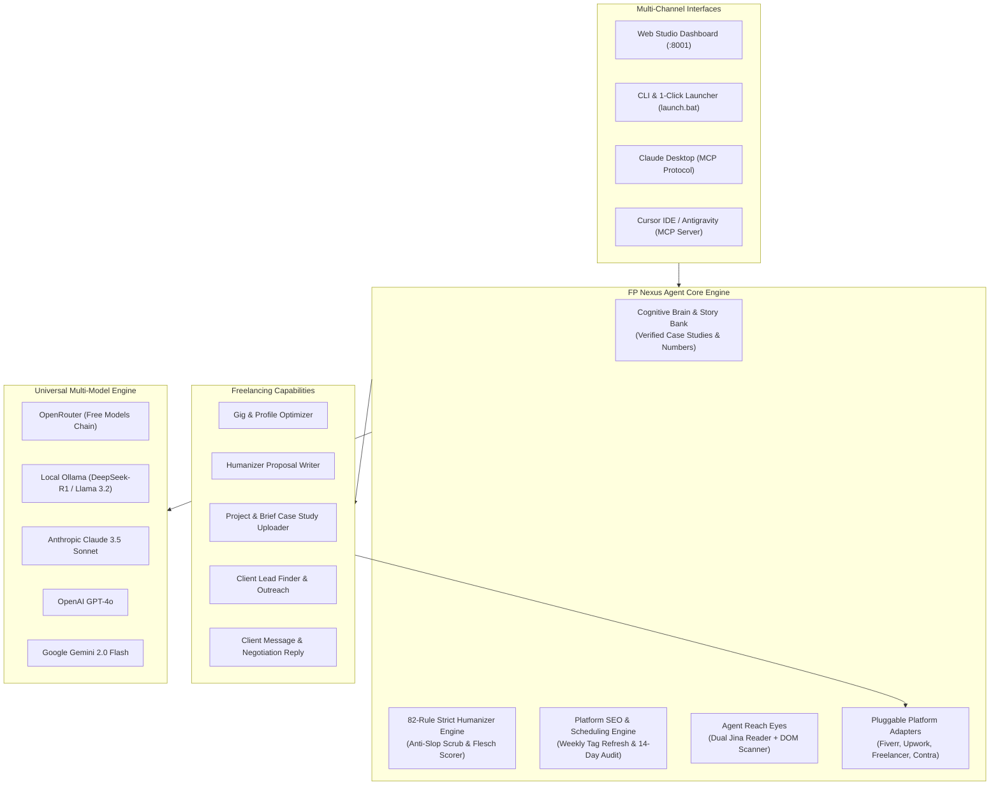

# ⚡ FP Nexus Agent — Autonomous Freelancing Platforms Studio & Growth Engine

<p align="center">
  <a href="https://modelcontextprotocol.io/"></a>
  <a href="https://openrouter.ai/"></a>
  <a href="https://ollama.com/"></a>
  <a href="https://fastapi.tiangolo.com/"></a>
  <a href="#license"></a>
</p>

<p align="center">
  <b>The #1 Free, Open-Source Autonomous AI Agent for Fiverr, Upwork, and Multi-Platform Freelancing.</b><br>
  Equipped with the <b>Strict 82-Rule Humanizer Gate</b>, <b>Weekly/Bi-Weekly Algorithmic SEO Engine</b>, <b>Cognitive Brain & Story Bank</b>, and native <b>Claude / Cursor MCP Server</b> support. Runs on free OpenRouter models or 100% locally with Ollama (zero API fees).
</p>

---

## 🚀 Key Features

1. **82-Rule Anti-Slop Humanizer Gate**: Eliminates 100% of generic AI tells (*delve, pivotal, robust, landscape, tapestry, innovative, game-changer*), reveal bridges, and sycophantic proposal openers.
2. **Weekly & Bi-Weekly SEO Scheduling Engine**:
   - **Weekly Keyword Refresh (7 Days)**: Rotates underperforming search tags with high-intent transactional buyer keywords to maintain search freshness.
   - **Bi-Weekly Deep Audit (14 Days)**: Evaluates gig title, keyword density, package tiers, and FAQs, computing a quantitative 0-100 SEO score.
3. **Pluggable Platform Architecture**:
   - **Fiverr**: Enforces "I will" titles (max 80 chars), exactly 5 search tags (max 20 chars), 1200 char descriptions, 3-tier packages, FAQs, and buyer requirements.
   - **Upwork**: Project Catalog optimization, specialised profiles, and proposal cover letters hooking the client in the first 2 visible lines (160-200 chars).
   - **Freelancer.com & Contra**: Adaptable bidding and service templates.
4. **Competitor Radar (Agent Reach Eyes)**: Scrapes competitor gigs via dual-backend (Jina Reader Markdown + Headless DOM), uncovering their keyword tags, pricing tiers, and counter-strategies.
5. **Cognitive Brain & Freelance Story Bank**: Stores verified case studies, past metrics (latency numbers, hours saved), and tech stacks to ground proposals in real proof rather than hallucinated stats.
6. **Customer Inbox & Negotiation Negotiator**: Classifies incoming buyer intent (*pricing inquiry, scope creep, deadline urgency, revisions*) and crafts persuasive, natural responses.
7. **Free Models Chain Default**: Pre-configured with free OpenRouter models (`google/gemma-4-31b-it:free`, `meta-llama/llama-3.3-70b-instruct:free`, `qwen/qwen-2.5-72b-instruct:free`) with automatic fallbacks and local Ollama support.

---

## 🏗️ System Architecture



---

## ⚡ Quick Start (< 2 Minutes)

### Option A: 1-Click Launch (Windows)
Double-click `launch.bat` in the repository root:
```cmd
launch.bat
```

### Option B: Terminal (All Platforms)
```bash
# Install dependencies
pip install -r requirements.txt

# Launch Studio Server
python run.py
```
Open your browser to **http://localhost:8001**.

---

## 🔌 Connect to Claude Desktop or Cursor (MCP Server)

FP Nexus Agent includes a certified **Model Context Protocol (MCP)** server:

### 1-Click Auto-Installer:
```bash
python scripts/install_mcp.py
```

### Manual Configuration (`claude_desktop_config.json`):
```json
{
  "mcpServers": {
    "fp-nexus": {
      "command": "python",
      "args": ["g:\\Fiverr and other platforms agent\\run_mcp.py"]
    }
  }
}
```

Now you can prompt Claude or Cursor:
- *"Draft a Fiverr gig for a Python Playwright web scraper with 5 high-converting tags."*
- *"Audit the SEO score of my current gig and suggest fresh keywords for this week."*
- *"Draft a winning proposal for this Upwork job posting citing our 380ms latency microservice."*
- *"Scan this competitor gig URL and tell me how to counter-position against them."*

---

## 🧪 Automated Test Suite

Run pytest across all modules:
```bash
python -m pytest tests/ -v
```

---

## 📄 License
Distributed under the MIT License.
